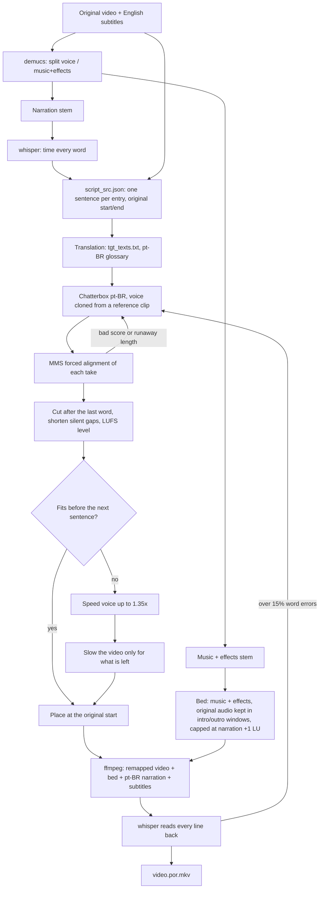
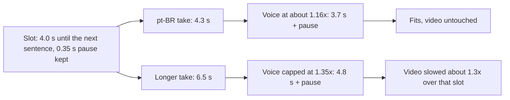

# Terráqueos 101: Earthlings 101 dublado em português

Dublagem em português do Brasil da série [Earthlings 101](https://www.youtube.com/playlist?list=PLaIo5yttvYt2dqQg7QGXkXqiWWNKEZQtx), de Zogg from Betelgeuse (Martin Kuppe, 2012 a 2014), mais três extras do mesmo canal. A série original é CC BY 3.0. Aqui estão as traduções, as legendas e o código que gerou a dublagem.

Brazilian Portuguese re-dub of the Earthlings 101 series (13 episodes + 3 extras). This repo holds the translations, subtitles, timings and the pipeline that rebuilds the dubbed videos from the originals. Media (videos, stems, TTS cache) is not versioned; it is regenerated.

## Assistir

- Episódio 1: [Humanidade: uma introdução para alienígenas](https://youtu.be/-2T6w4jRjaw)
- Episódio 2: [Origens: uma breve história da vida na Terra](https://youtu.be/svx1GaeNRK8)
- Episódio 3: [Sexo: por que os terráqueos fazem isso?](https://youtu.be/mGzYY3XdwpA)
- Episódio 4: [Ética: o que é o bem e o mal?](https://youtu.be/tAu71GbESn8)
- Episódio 5: [Imaginação: o que são jogos, sonhos e histórias?](https://youtu.be/doSZTUVRCuA)
- Episódio 6: [Estética: o que é a beleza?](https://youtu.be/vBKkPl0skw8)
- Episódio 7: [Mecânica social: gratidão e carma, as moedas secretas da sociedade](https://youtu.be/I_7rNyq4UkE)
- Episódio 8: [Humor: por que os terráqueos riem?](https://youtu.be/3C8yfvQS_VU)
- Episódio 9: [Comida: por que os terráqueos comem?](https://youtu.be/wYQbtxSTuqo)
- Episódio 10: [Linguagem: um recife de metáforas mortas](https://youtu.be/hQaIsA6wsqo)
- Episódio 11: Rituais: as engrenagens da sociedade (em breve)
- Episódio 12: Visão: como o mundo entra no cérebro (em breve)
- Episódio 13: Matemática: medindo x preguiça² (em breve)
- Extra: Física básica de discos voadores (em breve)
- Extra: Sem borda: a forma do universo (parte 1, modelos planos) (em breve)
- Extra: Sem borda 2: a forma do universo (espaço curvo) (em breve)

## What the pipeline does



How one sentence is fitted into the original timeline:



1. Downloads the original video and English subtitles (`yt-dlp`).
2. Splits narration from music and effects (`demucs`), and times every word of the narration (`whisper`).
3. Builds one sentence per entry with its original start/end (`out/script_src.json`).
4. Translation: `work/tgt_texts.txt`, one pt-BR line per sentence, with a series glossary (`GLOSSARY-ptbr.md`).
5. Voice: [Chatterbox Multilingual pt-BR](https://huggingface.co/ResembleAI/Chatterbox-Multilingual-pt-br), cloned from a short reference (`pipeline/voice/`).
6. Each take is force-aligned to its text (torchaudio `MMS_FA`). That gives real word times for the subtitles, cuts the clip right after the last word (Chatterbox often adds clicks or invented words at the end), shortens long silent pauses, and scores takes so runaway generations get re-rendered.
7. Sync: each sentence starts where the original did. If it does not fit, the voice speeds up (up to 1.35x) and the video slows down only for the rest. Intro, outro and effect windows keep the original audio and are never stretched.
8. QC: whisper reads every clip back and lines with more than 15% word errors are re-rendered.

Result: the dubbed videos run 0 to 5% longer than the originals.

## Layout

| Path | What |
|---|---|
| `epNN/`, `x1-*`, `x2-*`, `x3-*` | one folder per video |
| `.../source/video.en.srt` | original English subtitles |
| `.../work/vocals16k.json` | whisper word timings of the original narration |
| `.../out/script_src.json` | sentences with original timings |
| `.../work/tgt_texts.txt` | pt-BR translation, one line per sentence |
| `.../work/windows.txt` | music/effect windows kept from the original |
| `.../out/video.por.srt`, `video.eng.dubtimeline.srt` | subtitles on the dubbed timeline |
| `.../out/dub_report_por.json` | per sentence voice speed and video slow-mo |
| `pipeline/` | scripts and the full step-by-step (`pipeline/SKILL.md`) |
| `player/` | small web player for a TV on the LAN |
| `youtube/` | titles and descriptions used for the uploads |

## Rebuild one video

Needs Linux, an NVIDIA GPU (8 GB is enough), `ffmpeg`, `yt-dlp`, `whisper`, `uv`, `rubberband` support in ffmpeg, and two Python environments: the system one (`numpy soundfile pyloudnorm`) and one for Chatterbox (`chatterbox-tts==0.1.7`, torch 2.6 cu124, `num2words`).

```bash
S=pipeline/scripts; P=ep02; URL=https://www.youtube.com/watch?v=wQ68cQj2KqQ
CBX=~/.cache/chatterbox-venv/bin/python
$CBX $S/setup_chatterbox_ptbr.py                # once: builds ~/.cache/chatterbox-ptbr
bash $S/fetch.sh $URL $P en                     # source video and subtitles
bash $S/separate.sh $P en                       # stems + whisper
git checkout -- $P                              # keep the committed timings and texts
python3 $S/build_bed.py $P --windows "$(cat $P/work/windows.txt)"
$CBX $S/chatterbox_tts.py $P --ref pipeline/voice/ref_pm_alex.wav
python3 $S/dub.py $P --engine chatterbox --lexicon lexicon-ptbr.json --max-speed 1.35 --voice-first
```

Output: `$P/out/video.por.mkv` with pt-BR audio and pt-BR and English subtitle tracks.

## Licenses

- Original series: "Earthlings 101" and extras by Zogg from Betelgeuse (Martin Kuppe), [CC BY 3.0](https://creativecommons.org/licenses/by/3.0/). Original links are in each `youtube/*.txt`.
- Translations, subtitles and timings in this repo: [CC BY 4.0](https://creativecommons.org/licenses/by/4.0/), crediting the original as above.
- Code (`pipeline/`, `player/`): MIT, see `LICENSE`.
- Voice: Chatterbox (MIT) by Resemble AI; the reference clip was generated with Kokoro-82M (Apache 2.0).
